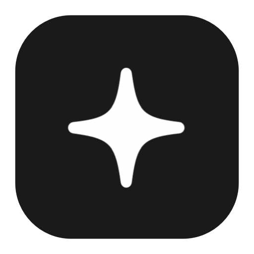

<p align="center">
  
</p>

<h1 align="center">GrokBar</h1>

<p align="center">
  Your Grok usage limits, in the macOS menu bar, in your local timezone.
</p>

<p align="center">
  <a href="https://github.com/GordonBeeming/grok-bar/actions/workflows/build.yml"></a>
  <a href="https://github.com/GordonBeeming/grok-bar/releases/latest"></a>
  
</p>

GrokBar shows your Grok plan limits in the menu bar. The menu-bar item shows the highest usage percentage. The dropdown lists each limit the Grok CLI returns, with a progress bar, the reset time in your timezone, and whether you're ahead of a steady pace through the window. When the CLI reports a prepaid balance, that amount is shown in dollars under the limits.

Turn on local telemetry to keep a history of those limits and of token totals from Grok sessions on this Mac. [Bar UI](https://github.com/GordonBeeming/bar-ui) reads that history.

The same menu bar for Claude is [ClaudeBar](https://github.com/GordonBeeming/claude-bar). For Codex, see [CodexBar](https://github.com/GordonBeeming/codex-bar).

## Install

```sh
brew install --cask gordonbeeming/tap/grok-bar
open -a GrokBar
```

GrokBar needs macOS 15 or later on Apple Silicon, and the [Grok CLI](https://x.ai/grok) installed and signed in with `grok login`.

The app launches at login by default. You can turn that off in Settings.

### From source

```sh
make install
open /Applications/GrokBar.app
```

`make install` builds a release binary and signs it with an available Apple Development identity, falling back to ad-hoc signing. It replaces `/Applications/GrokBar.app`, which is where the Homebrew cask installs the app.

## Settings

Open **Settings…** from the dropdown:

- **Usage colours.** Keep the default 75% warning and 90% critical levels, or drag the two splitters.
- **Pace flame.** Show a flame beside the menu-bar percentage when usage is ahead of a steady pace. A weekly limit ahead of pace uses the stronger red. Other windows stay orange.
- **Fuel tank mode.** Flip every percentage and bar from used to remaining. A limit starts full and drains toward empty. Colours, the pace flame, and the steady-pace marker still track real usage, so a nearly empty tank still turns red.
- **Celebrations.** Choose a full-screen reaction for a session reset, a weekly reset, a monthly reset, or crossing the weekly pace line. Each one can be turned off.
- **Telemetry.** Off by default. Records OTLP JSON to `~/Library/Application Support/GrokBar/Telemetry`. You can choose another folder or open it in Finder. The default capture interval is five minutes (1 to 1,440) and the default retention is 90 days (1 to 3,650, or unlimited). See the [telemetry format](docs/telemetry.md).
- **Launch at login.** On by default for an installed app.

Bar UI can change the telemetry settings by opening `grokbar://telemetry`. GrokBar asks you to confirm before it applies anything. `grokbar://settings` opens this window.

## How it works

GrokBar runs `grok agent stdio` and asks it for billing once a minute, and again when you open the menu if the last reading is more than 30 seconds old. The CLI stays responsible for sign-in. GrokBar never reads `~/.grok/auth.json` and never refreshes tokens.

A temporary drop in a percentage has to show up in three readings before the menu or a celebration treats it as real. A window reset, or a change of plan, is accepted on the first reading. A plan change also reseeds the celebration baseline, so a plan upgrade doesn't look like a reset.

If `grok` isn't on the app's `PATH`, GrokBar looks in Homebrew, `/usr/local/bin`, `~/.local/bin`, `~/.grok/bin`, Volta, nvm, and fnm. Set `GROK_PATH` to the executable if it lives somewhere else.

When the CLI says you need to sign in, the menu says "Sign in with grok login". When the CLI isn't installed, it says "Install the Grok CLI and sign in with grok login".

## Dev loop

```sh
make run    # Run directly from source
make test   # Build the tests and run them with xcrun xctest
```

Usage mapping, formatting, thresholds, celebration detection, and snapshot stabilization live in `GrokBarCore`. The app target is a SwiftUI `MenuBarExtra` on top.

## Releasing

Publish a GitHub release tagged `vX.Y` (for example `v0.1`). CI runs the tests, signs with a Developer ID, notarizes, staples, uploads `GrokBar-X.Y.dmg`, and commits the signed cask to `GordonBeeming/homebrew-tap`.

Local setup, packaging, the `prod` environment secrets, and the release steps are in the [development and release guide](docs/development.md).

## License

GrokBar is released under the [MIT License](LICENSE).

xAI owns the Grok name and the xAI logomark. The menu-bar glyph is an original sparkle, drawn from the system symbol of that name. It is not the xAI logo. If you fork GrokBar, keep that separation: don't swap in xAI artwork unless you have the rights to use it.
